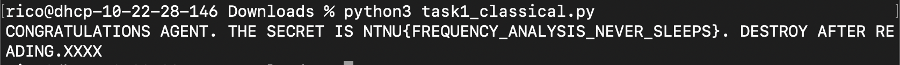

# Caesar's Column

**Category:** Crypto / Classical
**Challenge:** *A message was protected with two classical ciphers, applied in this order: columnar transposition (keyword = 6 different letters, unknown), then a Caesar shift (1–25, unknown). Recover the plaintext. Flag format `NTNU{...}`.*

## Recon

The challenge ships the full encryption code plus the ciphertext:

```python
def encrypt(plaintext, key, shift):
    return caesar(columnar_encrypt(plaintext, key), shift)
```

```
TKFVYI WER__JJRIXIKR VZLLRZVVUPIZOXR .J EH_JMV FVUOFLEEVVEITCEJ}KWV.ECJK KKVPPVC.IKRORZXKTJ{VEJIGV  EO
```

What the code tells us:

- **Caesar** only shifts `A–Z`. Spaces, `{`, `}`, `_`, `.` pass through untouched, so the flag braces are still visible in the ciphertext, just in the wrong place.
- **Transposition** pads with `X` to a multiple of 6. The ciphertext is 102 chars → **17 rows × 6 columns**.
- The keyword letters don't matter, only the **column order** they produce. 6 distinct letters → `6! = 720` possible orders.

Total keyspace: `720 orders × 25 shifts = 18 000` candidates. Trivial to brute force.

## How columnar transposition works

Write the plaintext into rows under the keyword, then read the columns out **top to bottom**, in **alphabetical order of the keyword letters**.

Example: `HELLOWORLD` with keyword `GOLD` (pad to 12 with `X`):

```
G O L D
-------
H E L L
O W O R
L D X X
```

Alphabetical order of the key is `D, G, L, O`, so read those columns:

| Column | Reads | 
|---|---|
| D (1st) | `LRX` |
| G (2nd) | `HOL` |
| L (3rd) | `LOX` |
| O (4th) | `EWD` |

Ciphertext: `LRXHOLLOXEWD`

**Decrypting** reverses it. The ciphertext is just the columns glued together, each `rows` chars long. Cut it into chunks, put chunk `k` back into column `order[k]`, and read the grid row by row.

## Exploitation

### Order of operations

Encryption was transposition → Caesar, so decryption is un-Caesar → un-transpose. In practice the order doesn't even matter: Caesar changes *what* each character is, transposition changes *where* it sits, so they commute.

### Undoing the transposition

```python
def columnar_decrypt(text, order):
    cols = len(order)
    rows = len(text) // cols
    chunks = [text[k*rows : k*rows + rows] for k in range(cols)]

    grid = [None] * cols
    for k in range(cols):
        grid[order[k]] = chunks[k]          # chunk k belongs to column order[k]

    return "".join(grid[c][r] for r in range(rows) for c in range(cols))
```

### Recognising the right answer

The challenge warns that finding `NTNU{` isn't enough: swapping two columns that don't touch the flag leaves the flag readable but garbles the rest. So instead of stopping at the first hit, every candidate is **scored** by counting known words, and the highest score wins.

### Brute force

```python
from itertools import permutations

WORDS = ["WINNER", "SECRET", "IS", "FLAG", "NTNU{"]
def score(t):
    return sum(t.count(w) for w in WORDS)

best = (0, "")
for shift in range(1, 26):
    unshifted = caesar(CIPHERTEXT, -shift)
    for order in permutations(range(6)):
        pt = columnar_decrypt(unshifted, order)
        if score(pt) > best[0]:
            best = (score(pt), pt)
print(best[1])
```

Winning key: **shift 17**, column order **`(0, 4, 3, 1, 2, 5)`**.



```
CONGRATULATIONS AGENT. THE SECRET IS NTNU{FREQUENCY_ANALYSIS_NEVER_SLEEPS}. DESTROY AFTER READING.XXXX
```

The trailing `XXXX` is the transposition padding.

## Flag

```
NTNU{FREQUENCY_ANALYSIS_NEVER_SLEEPS}
```

## Takeaway

Stacking two weak ciphers doesn't multiply security in any meaningful way, it just multiplies two tiny keyspaces: `720 × 25 = 18 000` tries runs in under a second. Each layer also leaks on its own: Caesar preserves letter frequencies, and transposition preserves the letters themselves (and every non-letter, like `{` and `_`).

The interesting part is **automatic plaintext recognition**. When brute forcing, you need a scoring function that rewards real language, not just a single marker string, otherwise near-miss keys produce false positives. A word count works here; for harder cases, bigram/quadgram frequency scoring is the standard upgrade.
